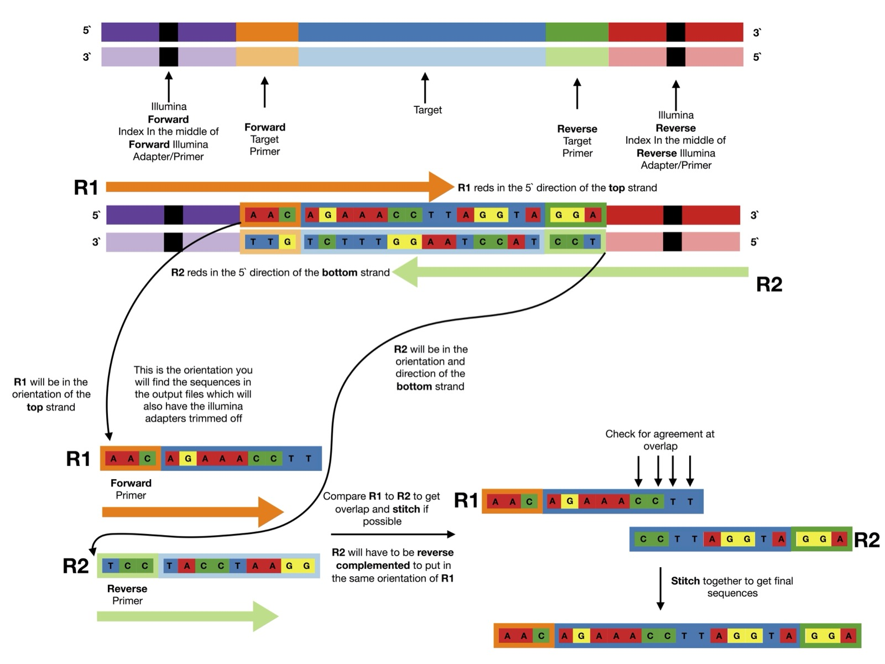
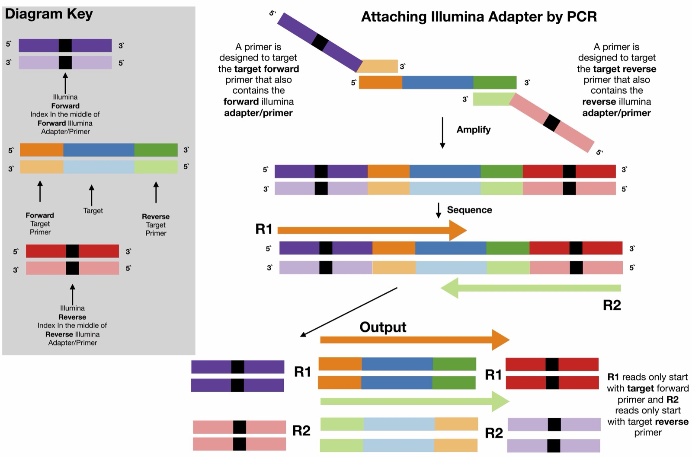
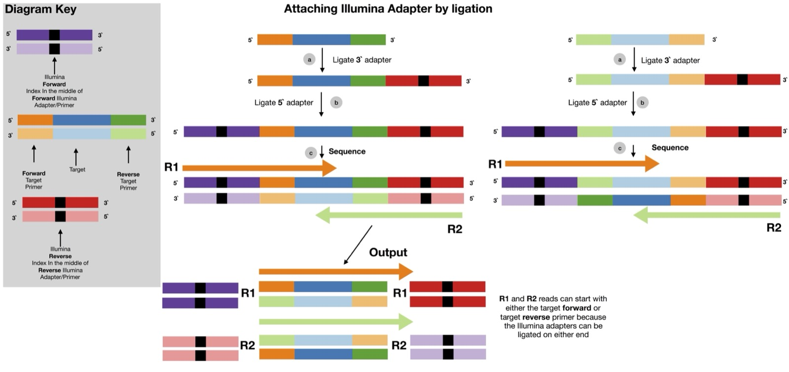

Illumina sequences each fragment from both ends, and reports the two reads of a pair (the mates)
in two files, R1 and R2. To handle them, SeekDeep needs to know which end each mate starts from and
whether the mates overlap.

## Which strand each mate reads

R1 starts right after the forward Illumina adapter and reads the top strand 5'→3'. R2 starts right
before the reverse adapter and reads the bottom strand 5'→3'. Illumina's software trims the
adapters off, so R1 starts with the forward target primer and R2 starts with the reverse target
primer. To compare the mates, R2 is reverse complemented into the same orientation as R1.

{fig-alt="An amplicon with Illumina adapters, target primers and the target. R1 reads the top strand from the forward primer and R2 reads the bottom strand from the reverse primer. R2 is reverse complemented and stitched to R1 where they agree."}

## How the mates overlap

Whether the mates overlap, and how, depends on the length of the target (primers included)
compared with the read length:

| Overlap status | When | What SeekDeep does |
|---|---|---|
| `r1EndOverR2Beg` | Target longer than one read but shorter than two (e.g. 200 bp on a 2×150 run) | Stitches the mates into one sequence |
| `r1BegOverR2End` | Target shorter than one read (e.g. 100 bp on a 2×150 run), so each mate reads through into the other primer and adapter | Stitches the mates and trims off the read-through |
| `NoOverlap` | Target longer than two reads (e.g. 400 bp on a 2×150 run) | Keeps the mates separate, so the target is clustered as `<target>-R1` and `<target>-R2` |

{fig-alt="Three panels showing how R1 and R2 overlap for a target longer than one read, shorter than one read, and longer than two reads."}

`extractorPairedEnd` takes the expected status of each target with `--overlapStatusFnp`.
[`genTargetInfoFromGenomes`](../reference/seekdeeputils.qmd#genTargetInfoFromGenomes) works it
out from the target's length in the reference genomes and the read length. elucidatornf does this
for you from `--illumina_clustering_paired_end_length`. In-line barcodes (MIDs) also take up read
length, so it allows for them when deciding which targets can be stitched.

## How adapters are attached

How the Illumina adapters are attached decides which direction the target sits in within a read.

**By PCR**: when the target primers carry the adapters, the forward adapter always sits next to
the forward primer, so every R1 starts with the forward primer.

{fig-alt="Adapters added by PCR with tailed primers, so every read is in the same direction."}

**By ligation**: when adapters are ligated onto the amplicons, either adapter can end up on either
end, so about half of the R1 reads start with the reverse primer.

{fig-alt="Adapters added by ligation, so reads come out in both directions."}

For ligation libraries, have SeekDeep look for the primers in both directions with
`--checkRevComplementForPrimers` (and `--checkRevComplementForMids` for MIDs). elucidatornf
checks a sample of the reads with
[`gatherInfoOnTargetedAmpliconSeqFile`](../reference/seekdeeputils.qmd#gatherInfoOnTargetedAmpliconSeqFile)
and adds these flags when the reads need them. It records the flags it chose in
`extractionReports/outSeekDeepExtractorFlags.txt`.
